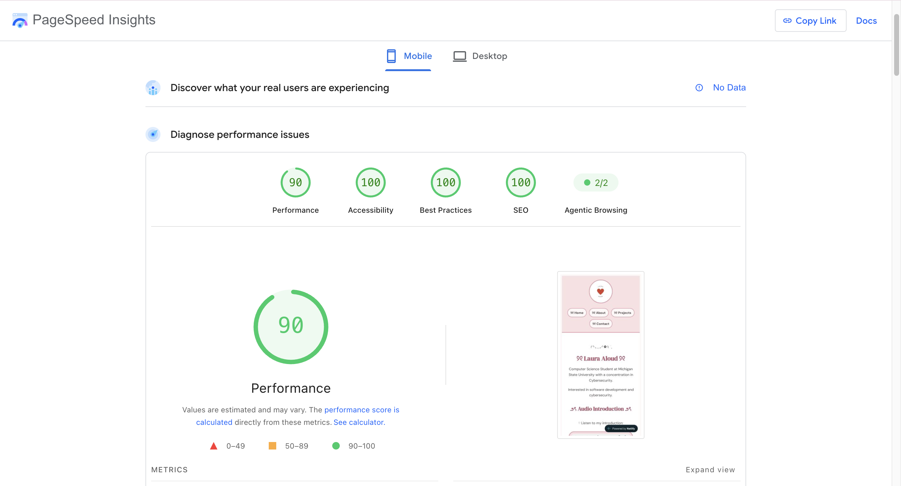
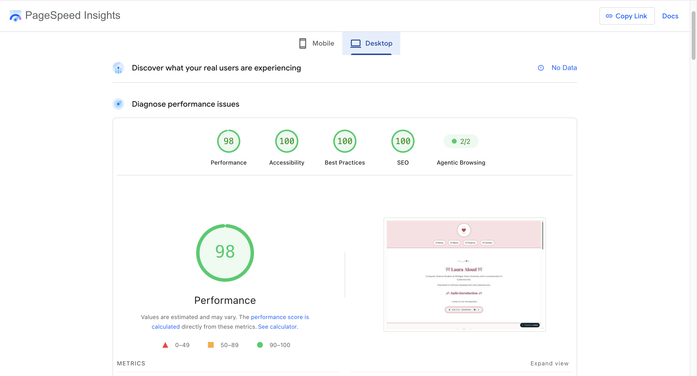

# ୨୧ Portfolio Accessibility Audit ୨୧

## ♡ Overview

I used Google PageSpeed Insights to audit my MI 349 portfolio website and identify accessibility issues. I made changes to improve color contrast and keyboard navigation while keeping my original design.

## ♡ Accessibility Findings

My initial accessibility score was 95.

PageSpeed Insights identified insufficient color contrast in some text and links, including the footer's "Back to top" link.

## ♡ Accessibility Fixes

- Updated heading and link colors to improve contrast.
- Darkened the footer link to make it easier to read.
- Added visible focus outlines for keyboard navigation.
- Added keyboard focus highlighting to navigation buttons.
- Improved keyboard accessibility for links, audio controls, and expandable project descriptions.
- Added smooth scrolling that respects reduced-motion preferences.
- Added `font-display: swap` to improve font loading.

## ♡ Keyboard Navigation

I tested my portfolio using only the keyboard. I used Tab and Shift + Tab to move between interactive elements and Enter to activate links and expandable project descriptions.

## ♡ Final Accessibility Results

After making the changes, I ran PageSpeed Insights again to check my accessibility score.

**Mobile Accessibility:** 100

**Desktop Accessibility:** 100

## ♡ Screenshots

### Mobile Accessibility Results

### Desktop Accessibility Results

## ♡ Tools Used

- Google PageSpeed Insights
- W3C HTML Validator
- Keyboard-only navigation testing